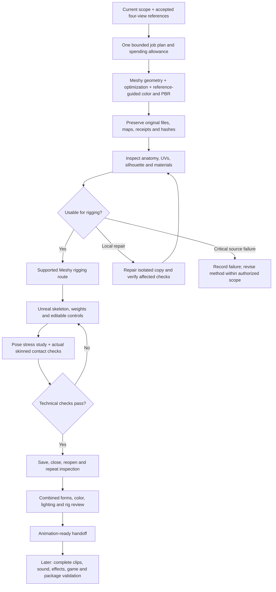

# Animation-ready creation contract — version 1.3

Owner amendment, 21 September 2026: every new creature creation includes color,
textures and rigging in one coordinated delivery. An explicitly bounded geometry
experiment remains possible only when the user asks for that narrower outcome.
Preserve historical experiments; their previous scope does not limit a new request.

If Meshy fails to produce a rig, authorized Unreal rig completion can use the same
preserved geometry and UVs. Record the provider failure, actual charge and local
rig source. The readiness checks remain unchanged; neither automatic binding nor
the fallback method earns acceptance without deformation evidence.

## What one delivery includes

| Component | Required evidence |
|---|---|
| Identity | Accepted four-view sources and hashes; generated front/sides/back/underside comparison, part inventory and defects |
| Geometry | Original high-detail output when available plus optimized working mesh; measured counts and articulation clearances |
| Materials | Base color, normal, roughness and metallic maps or a documented physically appropriate constant; UV/channel/import inventory, original files and Unreal comparison |
| Skeleton/skin | Actual hierarchy, rest transforms, semantic bone mapping, valid skin weights and rigid/flexible behavior |
| Editable controls | Root/body, spine/head, limb contacts/bend directions, relevant tail/jaw/appendage controls; saved source and reset instructions |
| Proof of readiness | Difficult-pose study, actual surface contact checks, viewed deformation, saved/cold-reopened Unreal assets and working inspection path |
| Provenance | Job IDs/settings/cost, source and output hashes, parent dependencies, known limits and actual owner decision when received |

Animation-ready means animation can be authored on this inspected asset. It does
not mean combat clips, audio, LODs, gameplay integration, performance and a packaged
release have all passed. Report those separately. A provider skeleton without
usable controls or tested skin is only an initial rig.

## Execution order

"One go" does not require a single API call. Generate color and PBR with the new
geometry when supported, then rig the resulting stable textured mesh. If geometry
and texturing are separate provider steps, keep them inside the same approved
candidate task and budget. Do not deliver an untextured interim mesh as completion.

For Meshy 7.1, the planned starting settings are standard geometry, four geometry
references and the same four independent texture references, PBR enabled, 2K maps,
image enhancement off and no humanoid pose conversion for a quadruped. Request
remeshing toward the candidate's provisional triangle budget and preserve the
pre-remesh output. Actual count and bending quality still require measurement.
Record `remove_lighting` explicitly: for new source generation, removal of baked
illumination is a proposed material-generation setting; it is not permission to
modify an already accepted base-color map.

## Reviews and spending

The latest owner instruction authorizes an isolated combined G3/G4 candidate for
review. Keep G3A/B/C and G4 technical records independently; preparing the complete
candidate does not grant owner acceptance. Reuse unchanged design decisions, do
not ask again about already tolerated reference misalignment, and include pending
G1 look comparison in the combined presentation. Stop dependent rigging when
anatomy is unusable. Full animation production follows acceptance of this candidate.

Prepare a single itemized allowance covering the proposed generation, optional
repair/remesh and supported rig operation. Record the total cap, per-operation
limits and maximum attempts. A subscribed account is not an unlimited allowance.
Check displayed website charges independently of API prices. Reconcile ambiguous
jobs before retrying; never spend a reserved allowance on extra generations or
unlisted texture variations. Read-only status/downloads require no renewed approval.

## Provider facts checked 21 September 2026

- [Multi-image API](https://docs.meshy.ai/en/api/multi-image-to-3d): independent multi-view texture inputs, PBR, remesh and pre-remesh preservation options.
- [Pricing](https://docs.meshy.ai/en/api/pricing): Meshy 7.1 standard multi-image with 2K/4K texture is 30 credits; separate remesh is 5; API rigging is 5. Website charges must be observed before use.
- [Rigging API](https://docs.meshy.ai/en/api/rigging): standard humanoids; do not use it for Cragstoat.
- [Website rigging guide](https://help.meshy.ai/en/articles/16231707-how-to-create-3d-animation-with-auto-rigging): quadruped route with walking; Smart Rig currently lacks animation-library support.

Recheck relevant capabilities/prices for later batches. These are dated provider
facts, not proof of this project's successful quadruped rig or completed asset.
