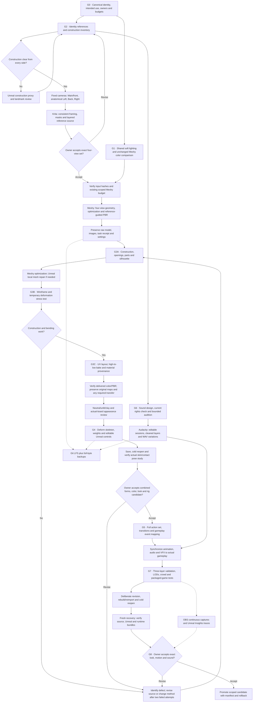

# Production engineering and revision contract

**Handbook 1.3, with the owner's colored/textured/rigged delivery amendment.**
This is the detailed amendment to G0–G8. Existing human approvals remain attached
to their exact revisions. Tool qualification is not creature acceptance.

## 1. Required sequence

- **G0:** select one stable catalogue ID; record exactly what this candidate is for.
- **G1:** approve one repeatable collection look; later creatures reuse its settings.
- **G2:** resolve physical construction before asking a generator to infer it.
- **G3A:** prove that the model contains the right shapes and connected parts.
- **G3B:** prove that the useful geometry can bend; remeshing alone is not proof.
- **G3C:** establish predictable UVs and material transfer before the final rig.
- **G4:** preserve both the deforming skeleton and editable animator controls.
- **G5:** author readable actions and validate their actual runtime transitions.
- **G6:** retain licensed source layers, editable mixes and event-driven variations.
- **G7:** test the complete asset under board, crowd, package and recovery conditions.
- **G8:** record the owner's exact decision and deliver the exact reviewed bytes.

The diagram's retry arrows mean reopen **only affected dependencies**. An audio
mix correction does not automatically regenerate a mesh. No retry arrow grants
another paid job, another upload, or an unbounded generation allowance.

## 2. Three kinds of reference

| Reference | Purpose | Required source |
|---|---|---|
| Identity | Character, expression, palette and silhouette | Approved illustrations and canonical brief |
| Construction | Explain how it exists and moves | Part inventory, dimensions, sections, contact and rigid/flexible map |
| Generator input | Give Meshy four compatible observations | Clean Main/front, Left, Back and Right exports of one revision |

Keep these separate in records. Do not upload a labelled construction sheet as a
generator view. Keep labels, dimensions and materials swatches in the layered
Krita source or supplementary reference packet. Do not mirror asymmetric anatomy.

When references disagree about appendage counts, hidden surfaces, rigid mounts or
clearance, create a coarse **Unreal** proxy first. This proxy is construction
evidence, not a replacement for the approved aesthetic and not finished geometry.
Review its assembly before rendering four inputs. Clear references do not require
an unnecessary proxy. Blender remains outside this route.

### Fixed camera contract

Copy [camera-set.json](templates/camera-set.json). Record scene revision/hash,
projection, transform, look-at target, ortho width or focal length/sensor, aspect,
resolution, exposure, pose and output hash **for every view**.

- Unreal coordinates: centimeters, +X forward, +Y anatomical right, +Z up.
- Main camera is in +X looking toward the subject; Left is in -Y; Back is in -X;
  Right is in +Y. Record any intentional exception rather than relabelling images.
- Use one shared pose and framing envelope. No independent resize that changes
  head/body or appendage proportions. A 1024-square fixture is not a production
  resolution requirement; select the actual supported upload resolution per batch.
- Mark at least head center, shoulder/hip pivots, ground/hover plane, extremities,
  rigid attachment roots and the asymmetric landmark. Compare projected landmarks
  between views. Do not invent numeric correspondence for independently painted art.
- Stylized or inferred views retain their actual origin and G2 human review.
- Save the layered `.kra` and clean PNG exports. Inspect alpha edges, embedded color
  profile and upload previews. This remains **four separate images**, not a collage.

## 3. G3A — construction checkpoint

Fill [construction-parts.csv](templates/construction-parts.csv). Each meaningful
part has a stable ID, parent, material, rigid/flexible/floating role, permitted
motion, pivot/contact, clearances and visibility in the four views.

Inspect untextured geometry from all sides, underside and board camera. Check:

1. Correct limb/toe/pipe/fin counts and no accidental bilateral duplication.
2. Limbs and petals separate where they need to move; contact is intentional.
3. Mouth, bell interior, shell openings and recesses have credible thickness/depth.
4. Small floating pieces have a defined attachment or intentional hover behavior.
5. Mesh intersections, fragments, holes and nonmanifold areas are recorded.
   A bell opening is intentional; a tear across an elbow is not.
6. A rigid bell, rocky ridge or ceramic pipe remains mechanically coherent.

Authoring parts are not automatically runtime actors. Prefer one skeletal mesh
with rigidly weighted regions when practical; separate components need a measured
reason. Record each visible part's runtime component and section assignment.

**Fail action:** name the defect and measured/visual before-and-after target. Repair
a copy in Unreal Modeling Mode, revise the input, or select a different generation.
After two revisions fail to improve the same critical defect, change method. Do not
hide construction errors with texture, continue smoothing indefinitely, or advance
rejected forms into a production rig.

## 4. G3B — deformation topology checkpoint

Triangulated or quad-dominant output can both work. Neither proves that edge flow,
vertex distribution, skin weights or joints are suitable for animation.

- Save wireframe close-ups at elbows/knees, shoulders/hips, jaw/neck, vine bends,
  fin/tentacle roots and rigid-to-flexible transitions.
- Inspect enough geometry around the joint to preserve its volume at the required
  bend. Spend triangles where the silhouette and bending need them.
- Build a temporary rig probe in Unreal or use the available Meshy rig. Test the
  hardest pose immediately: crouch, planted step, jaw opening, tight curl or fin cup.
- Record skeleton/rest pose, bind information, skin influence limits, actual bone
  names and affected part IDs. No copied Bellback vertex IDs or sole offsets.
- Capture both normal-speed motion and joint close-ups. Check collapsing volumes,
  stretching rigid regions, self-intersections, foot sliding and penetrations.
- If a local repair cannot preserve the approved appearance and support motion,
  reopen construction/source generation. Stop topology-dependent production until
  the method works. No claim that Unreal provides an automatic universal retopology.

The test rig is disposable; its findings are durable. Its existence is not G4
acceptance. When G3B succeeds, freeze the topology revision and identify changes
that would invalidate skin, UVs, LODs and animations.

## 5. G3C — UV and bake checkpoint

Copy [uv-bake.json](templates/uv-bake.json), even when no rebake is needed; record
`not_needed` with the reason and source hashes. Never use an empty record as a pass.

1. Preserve the untouched high-detail source and original maps.
2. Identify the low-detail target, UV channel and intended material sections.
3. Inspect a checker for stretch, shell boundaries, mirrored/overlapping UVs,
   texel density and padding. Record deliberately shared regions. Faces, toes,
   markings and material borders must remain readable at gameplay distance.
4. Bake onto the stable target UVs. Record source/target transforms, units, cage or
   projection distance, ray direction, texture resolution, gutter and sample count.
   Isolate nearby body parts when projections bleed onto one another.
5. Compute valid tangents before tangent-space normal baking. Record normal-space
   convention and any green-channel conversion. A conversion creates a derivative.
6. Inspect seams, black rays, flipped normals and color cross-bleed under rotating
   neutral light and the real board light. Hash the exported maps and settings.
7. Freeze mesh/UV/material versions before the final rig and animation bake.

**Color preservation:** accepted original base-color bytes remain immutable.
If changed UVs require resampling, save a separate, traceable **color-preserving
derivative** with a different hash. Preserve the palette and markings; record the
mapping and compare unlit matched views side by side. A new hash does not by itself
mean recoloring, and a matching hash does not prove correct Unreal appearance.
Repainting or deliberately changing color still needs a new owner decision.

Use sRGB for base color. Roughness/metallic/normal data must use the appropriate
linear interpretation and Unreal compression/sampler settings. Record packed
channel meanings explicitly; do not assume every provider uses the same packing.
If a roughness or metallic map is absent, a reviewed constant can be correct.
Do not fabricate a detailed-looking map just to satisfy a four-file checklist.

## 6. Materials and shared review scenes

The visual standard remains soft storybook daylight with stable exposure and
readable shaded surfaces. Preserve the project's DX11 baseline; do not enable
Lumen, ray tracing or virtual shadow maps as an unmeasured cure for dark artwork.

| Material family | Shared mechanism | Candidate-specific review |
|---|---|---|
| Organic opaque | Base color, normal, roughness; restrained surface response | Bark, moss, fur and face separation |
| Rigid ceramic/metal | Controlled roughness and actual metallic mask/constant | Bell/pipe edges, glaze/brass highlights |
| Thin foliage/membrane | Deliberate two-sided treatment when necessary | Petal/fin readability and overdraw |
| Glass-like shell | Start with readable opaque treatment; evaluate transparency separately | Reefglass silhouette, internal detail, crowd cost |
| Contained light | Authored emissive mask limited to a real luminous part | Ability signals and bloom clipping |

Reuse material logic and parameter naming. Do not make a recolor multiplier part
of the base-color path. Emissive is for a designed luminous feature, not whole-body
brightness repair. Family specifications are not evidence that all five materials
have been built and tested on future creatures.

Maintain two saved scenes: neutral inspection and actual board lighting. For each
candidate capture unlit/base color, clay, lit close-up, all four sides and gameplay
camera. Record camera, renderer, exposure, texture/mip residency and light settings.
Changing the shared look reopens affected color/lighting evidence, not old approval
of the preserved baseline package.

## 7. Rig families and inspectable controls

Three separate deliverables are required:

1. **Deform skeleton:** stable hierarchy, names, rest transforms, skin weights,
   rigid regions and attachment sockets.
2. **Animator controls:** editable Control Rig or equivalent Unreal source with
   clear names, limits and diagnostic poses; not merely a baked motion clip.
3. **Runtime motion:** clips and presentation logic appropriate to the game.
   Preserve the editable controls even if runtime uses only baked animations.

Select a family from quadruped, multiple-contact/root, flexible chain/jaw,
rigid floating assembly, serpentine, winged quadruped, soft hovering/swimming,
coordinated multi-body assembly, or humanoid/mechanism. Reuse contact solvers,
secondary-motion patterns, stress recipes and naming conventions. Do not impose
one creature's skeleton or skin correspondence on a different anatomy.

Record expected channels: root/body offset, spine/crouch/breath, head look, limb
IK/FK or equivalent joint control, foot/root contact, jaw, tail/vines, rigid props,
and optional secondary motion. Include an exact path to each editable control asset
and a demonstration sequence exercising its range. An absent elbow/body control
cannot pass because the walk happens to look acceptable.

## 8. Motion readability and gameplay

Keep Idle, Move, Attack, Active, Hit, Defeat and Victory, plus start/stop/turn and
the transitions required by the hero. Mark any truly inapplicable clip explicitly.
Meshy capabilities are rechecked at the time of use; an unavailable quadruped or
nonhumanoid library is completed in Unreal, not described as already generated.

- Review anticipation → commitment/release → impact/result → recovery → next action
  continuously at normal speed. Freeze-frame pose quality is a separate check.
- Test slow/normal/fast attack rates, movement-rate variation, interrupted ability,
  lost or changed target, stun/hit overlap, defeat during an action and restart.
- Actual combat events trigger successful damage/heal/push sounds and VFX. Animation
  notifies may cue harmless preparation details; they do not award gameplay effects.
- Feet use actual sole/contact evidence through support phases. Grounded body
  lowering must not drag toes underground. Hovering assets have explicit height,
  tilt, shadow and recovery behavior.
- At a milestone, ask unfamiliar viewers what action they saw, which unit acted,
  what was hit/healed and when. Preserve actual answers. This is a small qualitative
  readability check, not a fabricated statistical study or automatic owner approval.

## 9. Budgets beyond polygon count

Copy [budget-profile.json](templates/budget-profile.json). Select explicit limits
before production; `null` means undecided, never unlimited or passed. Existing
acceptance thresholds remain the starting point; record justified exceptions.

Measure LOD triangles and silhouette, deforming bones, maximum skin influences,
material slots, render sections/chunks, component count, texture dimensions and
resident bytes, animation CPU time, shader/transparent overdraw, shadow cost and
the full motion/selection envelope. A 35k-triangle starting target is not a universal
performance guarantee. Record actual imported measurements, not generator labels.

Crowd scenarios must include 20 copies of a heavy creature, a mixed 20-unit board,
bench/preview views where active, simultaneous abilities/audio and LOD transitions.
If a future creature represents a swarm, measure every subpart: 20 units with 12
members means 240 visible members. This example does not author a new gameplay unit.

Capture warm-up and measured duration, resolution, renderer, scalability, CPU/GPU,
driver, RAM/VRAM, package hash and trace path. Record p50/p95/p99 frame time, hitches,
Game/Render/GPU time, memory and capture overhead. Evaluate the package independently
of the editor. An editor commandlet trace qualifies Insights access only; it cannot
stand in for a crowded-board GPU test. Each additional hardware profile needs its
own measurements.

## 10. Three validation layers

| Layer | Implemented entry point | Scope and evidence |
|---|---|---|
| Source | [asset_checks.py](../../tools/production/asset_checks.py) | Bytes, missing/LFS-pointer files, ordinary OBJ/GLB geometry, UV presence, image metadata, WAV format and selected numeric constraints |
| Unreal | [unreal_asset_validator.py](../../tools/production/unreal_asset_validator.py) | Explicit opt-in contracts: class, static bounds/scale, bones, sockets, required dependencies, sequence bindings/duration |
| Runtime | Existing candidate-specific package, contact, events, audio and performance recipes | Actual skinned motion, camera, combat outcomes, audio/VFX, selection, LOD, crowd and cold-launch behavior |

The source checker does not decode compressed glTF, prove UV overlap quality or
apply scene-node transforms to dimensions. Unsupported data fails its requested
inspection and is routed to editor inspection. OBJ has no reliable unit declaration.
The Unreal Python validator must be **explicitly registered each session**. A
successful built-in Data Validation commandlet with no Python callback is not a
pass for our custom contract. Use [run_unreal_checks.ps1](../../tools/production/run_unreal_checks.ps1)
with the actual contract file. Qualify a new engine version with bad fixtures again.

Known failures are tested deliberately: stale hashes, missing source, unhydrated
LFS pointer, wrong scale, missing clip/dependency, missing socket and broken binding.
Keep positive fixtures too so a validator that rejects everything cannot pass.
The current tooling does not claim universal material/weight/LOD/cook-dependency
inspection; those checks remain mandatory candidate evidence and are extended as
the next complete creature pilot provides concrete contracts.

## 11. Deliberate revision, cold reopen and recovery

G7 now requires an explicit editability test, copied from
[revision-recovery.json](templates/revision-recovery.json):

1. Seal the reviewed candidate's inputs and editable sources.
2. Create a new diagnostic revision; choose a controlled change such as a socket
   offset, animation key or UV-preserving local correction.
3. Rebuild/reimport only affected assets using recorded settings. Check name, scale,
   skeleton, material bindings, cues and dependencies against the expected diff.
4. Close the editor, reopen from disk and exercise the changed result. An in-memory
   object or unsaved package does not prove persistence.
5. Restore an independent copy from backup/LFS objects. Verify full bytes, then
   open the native source and launch the corresponding package.
6. Retain the original accepted candidate, revised evidence and rollback command.
   A successful change does not give the revised artwork human acceptance.

Deliver three separately identifiable bundles:

- **Raw source:** input views, Meshy model/maps/receipt, original sound and rights.
- **Editable production:** Krita/Audacity sources, Unreal assets/maps/rigs/sequences,
  construction/cameras, schemas, recipes and exact tool versions.
- **Runtime:** packaged executable plus launch instructions, manifests, evidence and
  acceptance tied to the exact package.

FBX/GLB is useful interchange, not a substitute for an editable Unreal Control Rig,
material graph or sound project. Git LFS pointers alone are not a backup. Back up
the LFS object store or complete hydrated bundles, including ignored local support.
Do not rewrite historical Git commits as part of normal setup. Remote LFS quota,
access and upload cost must be checked before publishing large binaries.

## 12. Rollout and present limits

The setup qualification uses diagnostic fixtures and an isolated Bellback copy.
It does not approve G1 lighting or complete five new creatures. Next: exact shared
look review → a complete Cragstoat pilot through revision/recovery → a second
anatomy → extend reusable rig/material/validator modules from measured results.

See [toolchain](TOOLCHAIN.md) for actual integration modes and
[qualification report](../../reports/pipeline-tools-20260921/README.md) for results.
